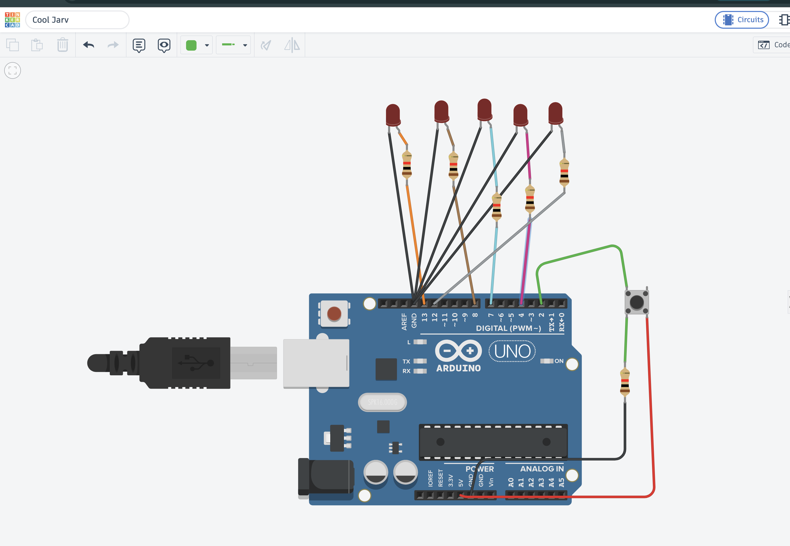
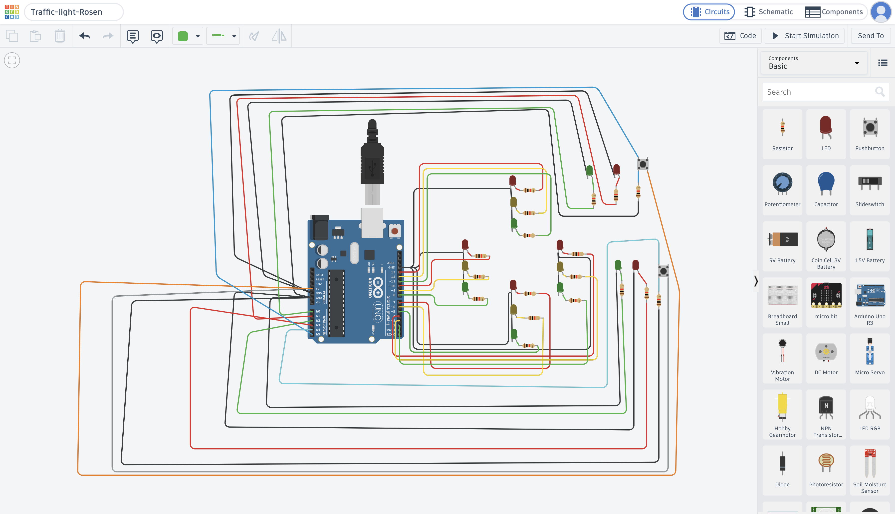

# Вградени системи (Embedded Systems)

Това репозиторий съдържа лабораторни упражнения и проекти по дисциплината **"Вградени системи"**.

## 👨‍🏫 Преподавател

* **Преподавател:** маг. Момчил Петков

## 🛠️ Използвани среди и хардуер

* **Платформа за симулация:** Tinkercad
* **Микроконтролерна платка:** Arduino (Uno/Nano)
* **Език за програмиране:** C++ (Arduino framework)

---

## 🧠 Научени основни функции и понятия

През първите упражнения усвоихме работата с основните структури и функции в Arduino:

* `void setup()` – функция за първоначална настройка (изпълнява се веднъж).
* `void loop()` – главен цикъл на програмата (изпълнява се безкрайно).
* `pinMode(pin, mode)` – задаване на режима на пин (`INPUT`, `OUTPUT`, `INPUT_PULLUP`).
* `digitalWrite(pin, value)` – подаване на цифров сигнал (`HIGH` или `LOW`).
* `digitalRead(pin)` – четене на цифров сигнал от пин.

---

## 📁 Структура на репозиторито

За всяка задача има папка, която съдържа програмния код (`.ino` файл) и снимка на схемата от Tinkercad:

```
.
├── project-01-button-leds/
│   └── main.ino          # Код на програмата
├── project-02-traffic-lights/
│   └── main.ino          # Код на програмата
├── schematics/           # Папка със снимки/скрийншоти на схемите
│   ├── project-01.png
│   └── project-02.png
└── README.md
```

---

## 📅 Проекти и Схеми

По-долу са описани изпълнените задачи, линкове към съответния код и снимки на схемите от Tinkercad:

### 1. Управление на светодиоди с бутон
* **Описание:** При натискане на бутон се включват и изключват определени светодиоди. Използвани са `digitalRead()` за следене на бутона и `digitalWrite()` за управление на диодите.
* **Изходен код:** [`project-01-button-leds/main.ino`](./project-01-button-leds/main.ino)
* **Схема (Снимка):**  
  

---

### 2. Светофар за автомобили и пешеходци (Първи проект)
* **Описание:** Симулация на кръстовище със светофарна уредба за автомобили и синхронизиран светофар за пешеходци.
* **Изходен код:** [`project-02-traffic-lights/main.ino`](./project-02-traffic-lights/main.ino)
* **Схема (Снимка):**  
  

---